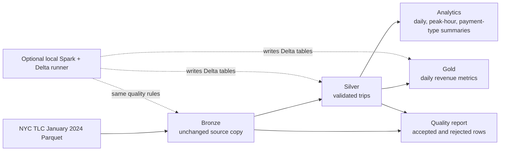

# NYC Taxi Data Pipeline

An end-to-end, reproducible data pipeline built with official NYC Taxi & Limousine Commission trip records. It downloads real Parquet data, applies Bronze–Silver–Gold transformations, records quality metrics, and creates an analytics-ready daily revenue table.

## Architecture



For the full layer and output descriptions, see [the architecture notes](docs/architecture.md).

## What it demonstrates

- **Ingestion:** downloads an official public Parquet dataset.
- **Quality gates:** rejects null timestamps, backwards trips, zero/negative distances, and nonpositive totals.
- **Layered storage:** writes durable Bronze, Silver, and Gold Parquet outputs.
- **Analytics:** produces daily trip volume, recorded trip totals, average trip distance, and average tip metrics.
- **Analytics outputs:** creates daily, peak-hour, payment-type, and pickup-zone summaries that can feed a dashboard or downstream report.
- **Spark and Delta Lake:** includes an optional local Spark runner that writes Delta tables using the same Bronze–Silver–Gold rules.
- **Verification:** unit tests cover invalid and all-invalid records; GitHub Actions runs them on pushes and pull requests.

## Run

```bash
python3 -m pip install -r requirements.txt
python3 scripts/download_data.py
python3 run_pipeline.py
python3 -m unittest discover -s tests -v
```

The raw input, derived warehouse files, and reports are intentionally ignored by Git. Anyone can reproduce the full pipeline locally from the documented public source.

### Optional Spark + Delta Lake path

The default command above is the recommended path: it is fast, local, and only needs DuckDB. To run the equivalent Bronze–Silver–Gold flow with local Spark and Delta Lake (Java 17 is required by Spark):

```bash
python3 -m pip install -r requirements-spark.txt
python3 run_spark_pipeline.py
```

This is local Spark and Delta Lake support—not a deployed Databricks workspace.

## Verified January 2024 run

The local DuckDB pipeline was run end-to-end against the official January 2024 Yellow Taxi file.

| Measure | Result |
| --- | ---: |
| Raw trip records | 2,964,624 |
| Validated Silver records | 2,871,892 |
| Rejected by quality rules | 92,732 |
| Daily Gold aggregates | 31 |
| Busiest pickup hour | 6 PM (206,503 trips) |
| Most active pickup zone ID | 161 (140,242 trips) |

The quality report deliberately flags the run for attention when any input rows are rejected; that makes rejected records visible instead of silently dropping them. The pipeline also rejects timestamps outside January 2024, so the Gold layer covers the target reporting month even when a source record contains an out-of-period timestamp.

## Outputs

- `warehouse/bronze/yellow_trips.parquet`: unchanged source copy.
- `warehouse/silver/valid_trips.parquet`: records passing the timestamp, distance, and total-amount rules.
- `warehouse/gold/daily_revenue.parquet`: daily trip volume, recorded trip total, average distance, and average tip. “Revenue” here means the sum of `total_amount`, including recorded tips and fees; it is not a net-collected-revenue claim.
- `reports/quality_report.json`: input, valid, rejected, and aggregate row counts.
- `reports/analytics/`: dashboard-ready daily, peak-hour, payment-type, and pickup-zone Parquet summaries plus `analytics_report.json`.

## Dataset

The project uses the January 2024 Yellow Taxi trip-record file published by the NYC Taxi & Limousine Commission. The agency publishes millions of public trip records and documents the dataset format on its [Trip Record Data page](https://www.nyc.gov/site/tlc/about/tlc-trip-record-data.page).

## Scope

This is a portfolio project built with public data only. It is not affiliated with the NYC TLC, Databricks, or any employer, and contains no employer or customer data.
